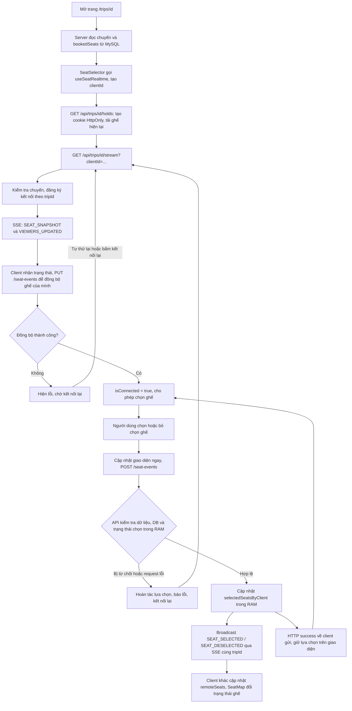
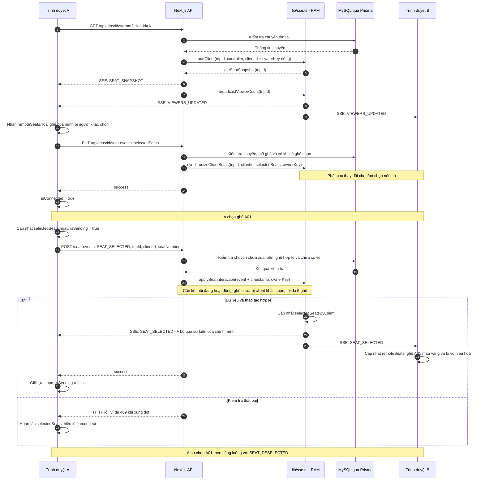
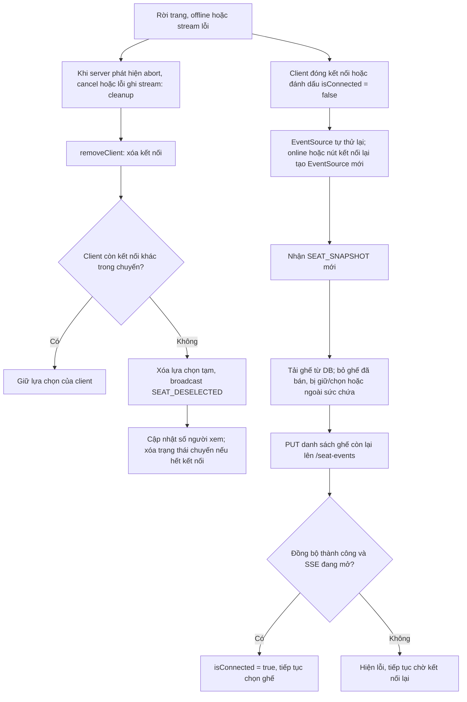

# Sơ đồ luồng xử lý realtime chọn ghế

Tài liệu mô tả code hiện tại của SGU Booking. Realtime đồng bộ ghế đang chọn và số người đang xem theo từng `tripId`.

Trình duyệt gửi thao tác bằng HTTP `POST`/`PUT`; server đẩy sự kiện về qua kết nối SSE (`EventSource`). Trạng thái chọn tạm được lưu trong RAM của một tiến trình Node.js. Vé và ghế đã đặt được lưu trong MySQL qua Prisma.

## 1. Sơ đồ luồng tổng thể

`SEAT_SNAPSHOT` chứa các lựa chọn tạm, ghế đã đặt và số người xem. Trước khi đồng bộ lựa chọn, hook tải lại sức chứa, booking và hold từ `/holds`; dữ liệu này cũng được kiểm tra mỗi 5 giây và khi có sự kiện `SEATS_CHANGED`. `PUT` có thể phát thêm sự kiện chọn/bỏ chọn nếu danh sách của client khác trạng thái trên server.

## 2. Hai người cùng xem một chuyến

Trong sơ đồ này, A và B có `clientId` khác nhau; B đã kết nối SSE đến cùng chuyến trước khi A vào trang.

API luôn kiểm tra chuyến và mã ghế. Với thao tác chọn, API kiểm tra thêm giờ xuất bến và vé chưa hủy. Quyền chọn/bỏ chọn được kiểm tra bằng khóa riêng do server suy ra từ cookie HttpOnly đã ký và `clientId` của tab. Khóa riêng không xuất hiện trong snapshot hoặc sự kiện; biết `clientId` công khai không cho phép thao tác thay trình duyệt khác. Các mutation kiểm tra nguồn yêu cầu. Nếu gửi POST thất bại hoặc timeout, hook hoàn tác và kết nối lại: server có thể đã nhận thao tác nhưng phản hồi HTTP bị mất.

## 3. Mất kết nối và đồng bộ lại

Server gửi comment `heartbeat` mỗi 15 giây để duy trì stream. Việc dọn kết nối xảy ra khi server phát hiện kết nối đã đóng hoặc ghi stream thất bại; không có bộ đếm giữ ghế 5 phút trong luồng chọn tạm này.

`clientId` được tạo một lần cho mỗi lần mount hook và được giữ khi kết nối lại. Số người xem đếm `clientId` khác nhau trong các kết nối hiện có, không phải số tài khoản đăng nhập.

## 4. Ranh giới giữa chọn ghế và đặt vé

Khi nhấn đặt vé, `SeatSelector` kiểm tra kết nối, thao tác đang gửi, ghế và thông tin hành khách, rồi gọi `POST /api/bookings`. `createBooking` kiểm tra lại database trong transaction `Serializable`: chuyến, ghế, vé chưa hủy, `SeatHold` còn hạn và số ghế trống. Sau đó tạo vé `PENDING`, giảm `availableSeats`, tạo PNR và trả kết quả để chuyển đến `/success?pnr=...`. Khóa unique `booking.activeSeat` bảo vệ ghế có vé hiệu lực.

Các điểm cần đọc đúng theo code hiện tại:

- Chọn ghế realtime chỉ ghi RAM. `createBooking` không kiểm tra quyền chọn trong RAM; database quyết định việc đặt vé thành công.
- Đặt vé và thay đổi trạng thái vé qua admin phát `SEATS_CHANGED` sau khi transaction commit. Hook tải lại ghế từ database; polling 5 giây bù sự kiện bị lỡ hoặc thay đổi từ tiến trình khác.
- Sau khi đặt vé và rời trang, cleanup có thể phát `SEAT_DESELECTED`. Ghế đã bán vẫn bị vô hiệu hóa dựa trên `bookedSeats` vừa tải, không phụ thuộc lựa chọn tạm đã được dọn.
- API riêng `POST /api/seats/hold` lưu `SeatHold` có hạn 5 phút và phát `SEATS_CHANGED`. `SeatSelector` không tự tạo hold nhưng hiển thị hold của người khác là ghế không khả dụng. `/holds` chỉ trả `seatNumber` và `isOwn`, không trả khóa sở hữu. Booking chuyển `clientId` công khai thành khóa riêng ở server trước khi kiểm tra hold.
- `globalThis.seatRealtimeStore` chỉ dùng chung trong một tiến trình Node.js. Các tiến trình hoặc máy chủ khác không chia sẻ kết nối và lựa chọn tạm; restart làm mất trạng thái RAM.

## 5. Đối chiếu sơ đồ với file

| File | Vai trò |
| --- | --- |
| [app/(client)/trips/[id]/page.tsx](../app/%28client%29/trips/%5Bid%5D/page.tsx) | Đọc chuyến và ghế đã đặt, truyền dữ liệu vào `SeatSelector`. |
| [components/trips/SeatSelector.tsx](../components/trips/SeatSelector.tsx) | Nối hook với giao diện và gửi yêu cầu đặt vé. |
| [components/trips/SeatMap.tsx](../components/trips/SeatMap.tsx) | Hiển thị ghế trống, bạn đang chọn, người khác đang chọn, đã đặt. |
| [hooks/useSeatRealtime.ts](../hooks/useSeatRealtime.ts) | Quản lý `EventSource`, state, POST/PUT, hoàn tác và kết nối lại. |
| [app/api/trips/[id]/stream/route.ts](../app/api/trips/%5Bid%5D/stream/route.ts) | Mở SSE, gửi snapshot, số người xem, heartbeat và cleanup. |
| [app/api/trips/[id]/seat-events/route.ts](../app/api/trips/%5Bid%5D/seat-events/route.ts) | Kiểm tra yêu cầu và database trước khi cập nhật lựa chọn tạm. |
| [lib/sse.ts](../lib/sse.ts) | Lưu kết nối và lựa chọn theo chuyến trong RAM, kiểm tra xung đột và broadcast. |
| [lib/validations/seat-realtime.ts](../lib/validations/seat-realtime.ts) | Schema Zod cho yêu cầu và sự kiện realtime. |
| [lib/seat-session.ts](../lib/seat-session.ts) | Ký cookie HttpOnly và suy ra khóa sở hữu theo tab; dùng `SESSION_SECRET` giống cơ chế đăng nhập. |
| [lib/seat-selection.ts](../lib/seat-selection.ts) | Loại lựa chọn không còn khả dụng khi kết nối hoặc cập nhật dữ liệu. |
| [app/api/bookings/route.ts](../app/api/bookings/route.ts) | Nhận yêu cầu đặt vé online với trạng thái `PENDING`. |
| [services/bookingService.ts](../services/bookingService.ts) | Kiểm tra và ghi vé vào database trong transaction. |

## 6. Kiểm tra bằng hai trình duyệt

1. Mở cùng một chuyến chưa xuất bến trong hai cửa sổ hoặc hai trình duyệt. Chờ kết nối hoàn tất và kiểm tra số người xem.
2. Ở A, chọn một ghế trống. A thấy ghế đang chọn; B thấy ghế màu vàng, không bấm được.
3. A bỏ chọn ghế. B thấy ghế trở lại trạng thái trống.
4. Mở chuyến khác ở cửa sổ thứ ba. Các thao tác ở chuyến đầu không ảnh hưởng chuyến này.
5. Ngắt mạng của A, quan sát thông báo mất kết nối; khi server dọn kết nối, B nhận sự kiện bỏ chọn. B có thể chọn ghế vừa được giải phóng.
6. Cho A online lại. A nhận snapshot, tải lại booking/hold và loại ghế đã bị B chọn hoặc đặt, rồi đồng bộ các ghế còn lại.
7. Khi admin hủy vé, trang đang mở tự nhận ghế trống trở lại; nếu lỡ SSE, lần polling kế tiếp cập nhật sơ đồ.

Các kiểm thử không dùng database: [tests/seat-realtime.test.cjs](../tests/seat-realtime.test.cjs) và [tests/seat-recovery.test.cjs](../tests/seat-recovery.test.cjs). Script [tests/seat-realtime.browser.cjs](../tests/seat-realtime.browser.cjs) tạo dữ liệu kiểm thử và chỉ nên chạy với database thử riêng.
